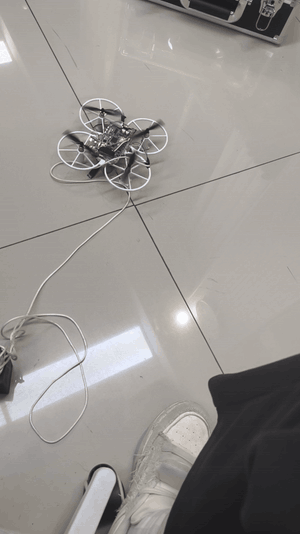
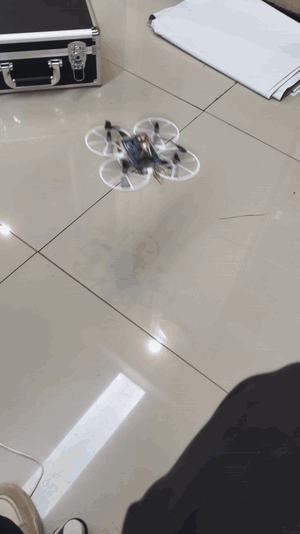
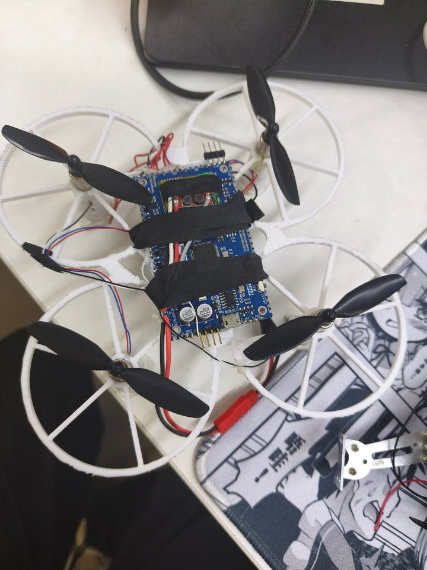
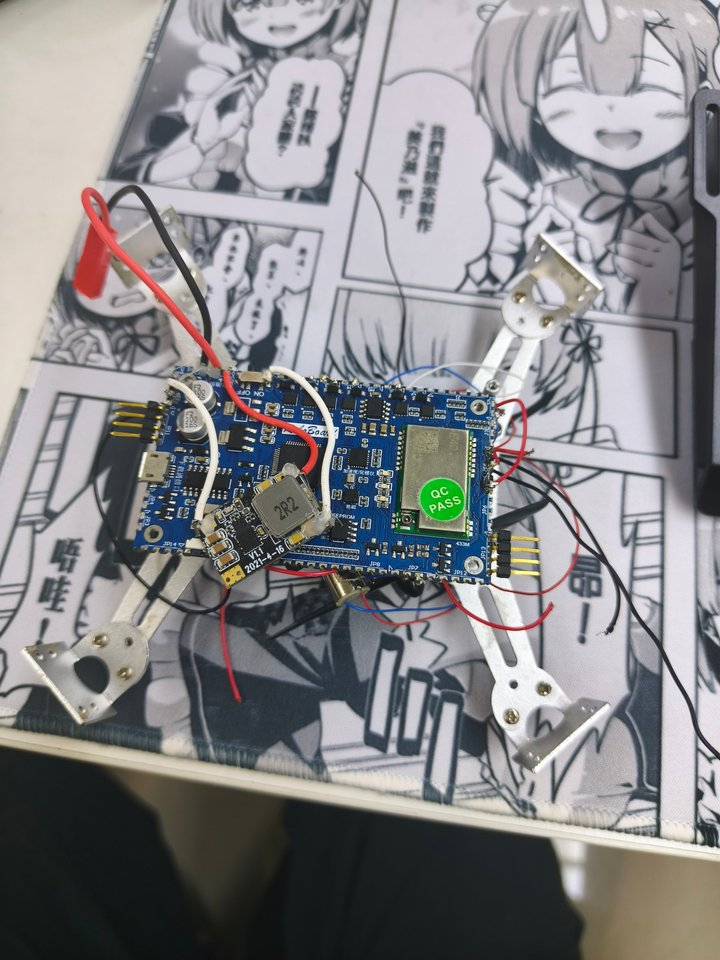
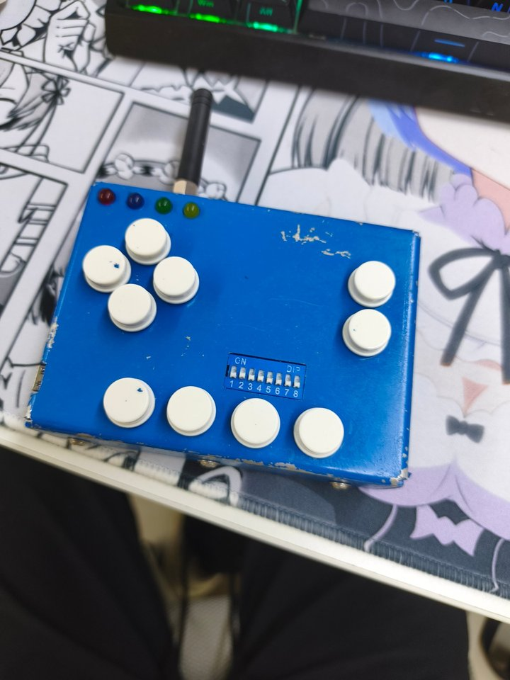
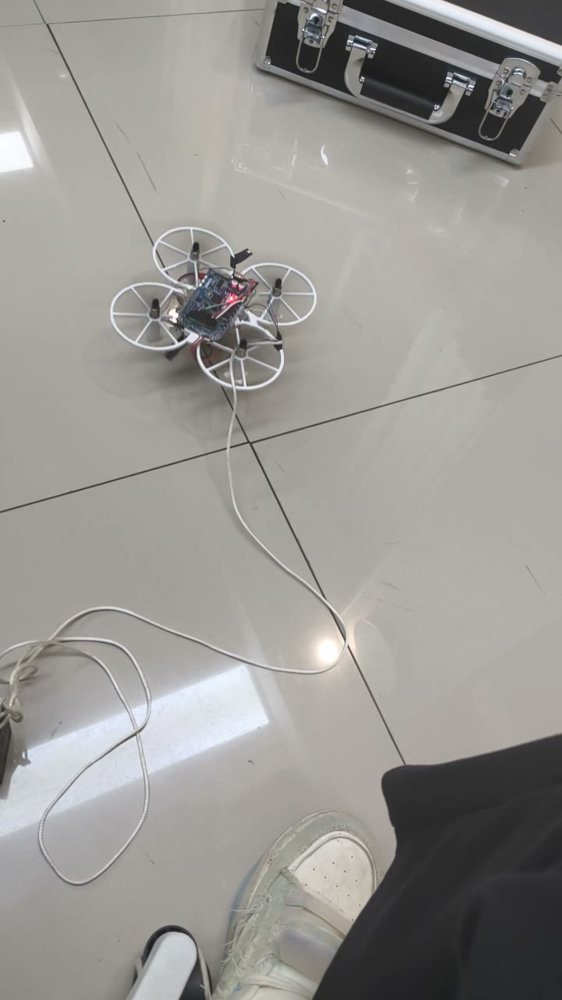
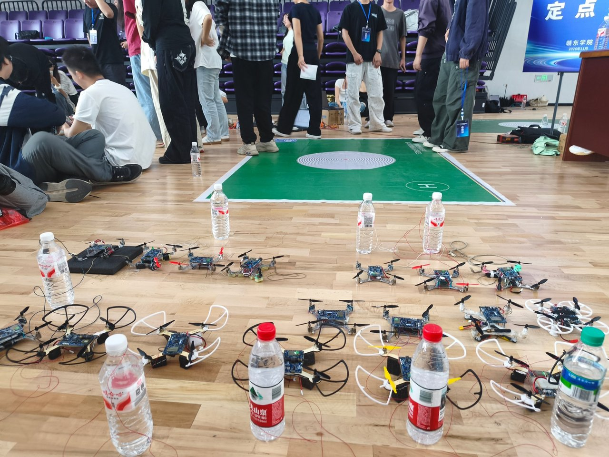
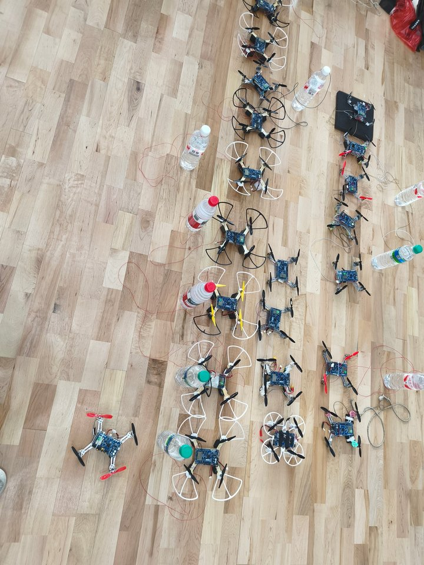

# F22 四轴飞行器 · 悬停控制工程

<p align="center">
  
  
</p>

<p align="center">
  <b>让一架手掌大小的四轴飞行器，在离地 20–100 cm 之间自主停住 5 秒以上</b><br>
  STM32F103RCT6 ｜ HAL + PlatformIO ｜ 三层串级控制 ｜ 飞行黑匣子
</p>

---

## 目录

- [1. 这是什么](#1-这是什么)
- [2. 关键结果](#2-关键结果)
- [3. 演示视频与图片](#3-演示视频与图片)
- [4. 硬件组成](#4-硬件组成)
- [5. 仓库结构](#5-仓库结构)
- [6. 快速开始（编译 / 烧录 / 按键）](#6-快速开始编译--烧录--按键)
- [7. 控制架构](#7-控制架构)
- [8. 日志与数据](#8-日志与数据)
- [9. 测试](#9-测试)
- [10. 已知限制](#10-已知限制)
- [11. 安全须知](#11-安全须知)
- [12. 文档索引](#12-文档索引)

---

## 1. 这是什么

2026 飞行巡航定点赛 V5.0 悬停组的参赛工程：**一键起飞后，飞行器自主保持在 20–100 cm 的某个高度、持续 5 秒以上，再一键降落**，全程不超过 1 m。

难点不在"飞起来"，而在"停得住"：推力差 1% 就会缓慢爬升或下沉，而这点差别人眼看不出来、手也反应不过来——所以必须把控制交给芯片，每 6 ms 修正一次。

本项目在实验室已有的套件、场地与工程规范上完成；个人工作集中在**控制参数调试、闭环代码修改与试飞数据分析**。

## 2. 关键结果

| 指标 | 结果 |
|---|---|
| 悬停高度 | 40–80 cm（合规区间 20–100 cm） |
| 悬停时长 | **≥ 5 秒**（达标） |
| 所需油门 | 约 80%，留有余量 |
| 横向漂移 | 已收敛，可稳定留在起飞点附近 |
| 控制频率 | 约 160 Hz（dt ≈ 6 ms） |
| 整机重量 | 约 40 g 级四轴，带桨叶保护罩 |

## 3. 演示视频与图片

### 3.1 室内系留试飞（点击下载 MP4）

| 视频 | 内容 | 时长 |
|---|---|---|
| [bench_hover_01.mp4](docs_media/video/bench_hover_01.mp4) | 地板上启动、油门爬升、离地悬停（系留绳保护） | 6 s |
| [bench_hover_02.mp4](docs_media/video/bench_hover_02.mp4) | 起飞后姿态保持，镜头跟随 | 6 s |
| [bench_setup_03.mp4](docs_media/video/bench_setup_03.mp4) | 上电、放置与调试过程 | 12 s |

> GitHub 不支持在 Markdown 中直接内嵌播放，上面两个 GIF 是视频的动图预览，点击表格里的链接可下载原视频。

### 3.2 图片

| 整机（带保护罩） | 飞控与机架 | 自制遥控器 |
|---|---|---|
|  |  |  |

| 系留地面调试 | 比赛现场（定位靶垫） | 赛前合影 |
|---|---|---|
|  |  |  |

<p align="center">
  <br>
  <sub>比赛当天同一场地，各队机器依次上场（非本队机器）</sub>
</p>

## 4. 硬件组成

| 部件 | 型号 / 说明 |
|---|---|
| 飞控主控 | STM32F103RCT6（HAL + PlatformIO，`board = genericSTM32F103RC`） |
| 姿态传感器 | MPU6050（I2C2 @0x68，陀螺仪 + 加速度计） |
| 气压计 | SPL06-001（I2C2 @0x76，本工程仅作辅助） |
| 高度传感器 | VL53L1X 激光测距（长距离模式，33 ms 测量 / 40 ms 周期） |
| 光流传感器 | PMW3901（水平位移估计，配合高度做定点） |
| 无线 | E49 433M 模组（JP12 / USART1，与板载 CH340 共用） |
| 电机 | 四路 M1 / M2 / M3 / M6，PWM 驱动 |
| 遥控器 | 自制发射端（`02_比赛工程/remote/tle100`），只有起飞 / 停止两个键 |

## 5. 仓库结构

```
f22_hal_demos1/
├── f22_hal_demos/
│   ├── 01_教学demo/           # 七课教学 demo、教程与手册
│   └── 02_比赛工程/           # 比赛固件主工程（本文重点）
│       ├── src/
│       │   ├── main.c         # 入口：初始化、主循环、按键与状态机
│       │   ├── flight/        # 闭环控制、传感器融合、飞行日志、遥控协议
│       │   ├── sensors/       # ToF / 光流 / 传感器总线驱动
│       │   ├── hal/           # 板级支持（PWM、I2C、UART、ADC）
│       │   └── bench/         # 台架测试程序（推力斜坡等）
│       ├── scripts/           # 编译检查、数据解码、采集与审计脚本
│       ├── tests/             # 主机侧单元测试（不需要硬件）
│       ├── remote/tle100/     # 遥控器固件
│       ├── docs/              # 设计、验证记录与传感器手册
│       └── platformio.ini     # 各编译环境（env）定义
├── docs_media/
│   ├── img/                   # README 用图片
│   ├── video/                 # 试飞视频（压缩版）与 GIF 预览
│   └── logs/                  # 日志说明与脱敏样例  ← 见第 8 节
├── 小飞机课题汇报_7分钟版.pptx
├── 小飞机课题汇报_演讲稿_7分钟.docx / .md / .pdf
└── 小飞机课题汇报_实验室版.pptx
```

> 本仓库为整理版：**不包含** `.pio` 编译产物、原始逐帧采集日志（`logs/`、`*.jsonl`）、历史备份快照（`archive/`）与大体量参考资料库（约 3.3 GB，留在本机）。

## 6. 快速开始（编译 / 烧录 / 按键）

### 6.1 编译

```bash
cd f22_hal_demos/02_比赛工程
pio run -e contest_flow_hold_wide_jp13            # 位置保持版（比赛主线）
pio run -e contest_imu_tof_low_hover_wide_jp13    # 无光流版（只做高度）
```

产物：`.pio/build/<env>/firmware.bin`

### 6.2 烧录（SWD / CMSIS-DAP）

```bash
openocd -f interface/cmsis-dap.cfg -f target/stm32f1x.cfg \
  -c "adapter speed 100" -c "init" -c "reset halt" \
  -c "flash write_image erase .pio/build/contest_flow_hold_wide_jp13/firmware.bin 0x08000000 bin" \
  -c "reset run" -c "shutdown"
```

SWD 偶发失败（`timeout waiting for algorithm` / `CMD_INFO failed`）时：把 `adapter speed` 降到 50、确认飞控已上电、或重新插拔调试器。写入后建议读回比对 sha256。

### 6.3 按键

| 按键 | 作用 |
|---|---|
| **F2** | 起飞（进入起飞斜坡，随后转自主高度控制） |
| **F3** | 降落 |
| **F4** | 急停（同时触发飞行日志落盘） |

> 起飞前先按一次 F4 清除上电残留的 PWM 锁存，否则可能直接进入 `OUTPUT_FAULT`。

## 7. 控制架构

三层串级，一次只解决一个问题：

```
第 3 层  位置保持   光流位移 → 期望速度 → 倾角指令（加分项）
第 2 层  高度控制   激光测距 → 期望爬升速度 → PI → 总距（比赛核心）
第 1 层  姿态控制   陀螺仪角速度环 + 角度环 → 四路差动（安全底线）
```

要点：

- **前馈**：悬停油门用固定/学习值（本机实测悬停带 800–830‰），PI 只做小修正；
- **抗饱和**：油门下砍有下限（不低于前馈 −12%），避免"砍过头 → 下沉 → 越掉越快"；
- **偏航门限**：无旋转补偿的光流在自转时会把旋转误判为平移，因此偏航角速度超阈值时暂停采信光流；
- **参数集中**：全部可调参数在 `src/flight/closed_loop_tuning.h`，均有 `#ifndef` 保护，可由 env 覆盖。

## 8. 日志与数据

本工程有**三套日志**，详见 [docs_media/logs/README.md](docs_media/logs/README.md)：

| 类型 | 存放 | 用途 |
|---|---|---|
| 串口遥测 `[CL] ...`（6 ms 一行，约 50 字段） | 上位机录制的 `.raw.log` | 实时状态机、传感器健康、闭环中间量 |
| **飞行黑匣子**（10 Hz × 内部 Flash 双 4 KB 槽） | 芯片 `0x0803E000` 起 8 KB | 复盘完整飞行曲线，掉电不丢 |
| 专项采集脚本 | `.jsonl` / `.csv` | 光流标定、遥控延迟、台架推力 |

**读黑匣子：**

```bash
openocd -f interface/cmsis-dap.cfg -f target/stm32f1x.cfg \
  -c "init" -c "reset halt" -c "dump_image /tmp/f22-log.bin 0x0803E000 0x2000" \
  -c "reset run" -c "shutdown"
python3 scripts/decode_flightdata.py /tmp/f22-log.bin --csv /tmp/flight.csv
```

**样例文件（脱敏节选）：**

- [`docs_media/logs/sample_telemetry_raw.log`](docs_media/logs/sample_telemetry_raw.log) — 串口遥测节选，可见 `[CAL]` 标定、`[FCAL]` 光流自检、`[CL]` 闭环状态行
- [`docs_media/logs/sample_ground_check_telemetry.csv`](docs_media/logs/sample_ground_check_telemetry.csv) — 从该日志解析出的短时起跳段（10 样本，最高 64 mm，仅演示字段含义）

**一次真实的数据判读（某次飞行节选）：**

| 时刻 | 高度 | 油门 |
|---|---|---|
| 2.4 s | 376 mm | 94% |
| 2.6 s | 302 mm | 98% |
| 3.2 s | 110 mm | 99% |

油门已接近饱和、高度仍在下降 → 结论是**推力不足**（电池/重量），不是控制算法错误；同一天更早的飞行 68% 油门即可稳住 630 mm。这一判读直接改变了后续方向：从"继续调参数"转向"先把动力余量做够"。

**判读经验：**

1. 先看 `fault` 再看现象（`OUTPUT_FAULT` 常是 PWM 锁存未清）；
2. 高度掉而油门顶到 99% → 动力不足；
3. `squal` 低 + `gyro_z` 大 → 机体自转中，光流不可信；
4. `tof_age_ms` 变大 → 激光受扰，应降级而非硬算。

## 9. 测试

```bash
cd f22_hal_demos/02_比赛工程
bash scripts/check_closed_loop.sh      # 主机侧回归：编译 + 多 profile 单元测试（无需硬件）
```

覆盖油门斜坡、起降状态机、光流位置环、PWM 看门狗、日志结构等。

## 10. 已知限制

| 项目 | 说明 |
|---|---|
| 光流轴序 | 尚未用地面标定验证（`CL_FLOW_AXES_VERIFIED = 0`），横移方向依赖经验配置 |
| 动力余量 | 同油门满电可飞 60 cm，电量不足只能 15 cm，需换高倍率电池或减重 |
| 下沉涡环 | 快速下降会掉入自身尾流，已改为禁止主动下降 |
| 惯性辅助 | 加速度互补滤波实测发散，已关闭并保留开关 |
| 气压计 | 一两米量程内分辨率不足，仅作辅助 |

## 11. 安全须知

1. 调试电机一律**拆桨**；
2. 首次上电先看串口 banner 的环境名与参数，确认烧的是对的固件；
3. 按规则系绳连接重物，场地留足半径；
4. 出现异响、突然偏转、落地不稳，先断电，再读黑匣子定位原因。

## 12. 文档索引

| 文档 | 内容 |
|---|---|
| [docs_media/logs/README.md](docs_media/logs/README.md) | 日志体系、字段表、读法、判读经验 |
| `02_比赛工程/docs/COMPETITION.md` | 比赛规则与实施进度 |
| `02_比赛工程/docs/CONTROL_DESIGN_2026-10-16.md` | 控制设计 |
| `02_比赛工程/docs/FLOW_ASSIST.md` | 光流辅助与位置保持 |
| `02_比赛工程/docs/AIRCRAFT1_CLOSED_LOOP.md` | 闭环实现说明 |
| `01_教学demo/教学总讲义.md` | 教学讲义（从通信到控制） |
| `小飞机课题汇报_演讲稿_7分钟.md` | 7 分钟汇报逐页讲稿 |

---

**致谢**：实验室提供的套件、场地、工程规范与讨论氛围，是本项目得以完成的基础。
